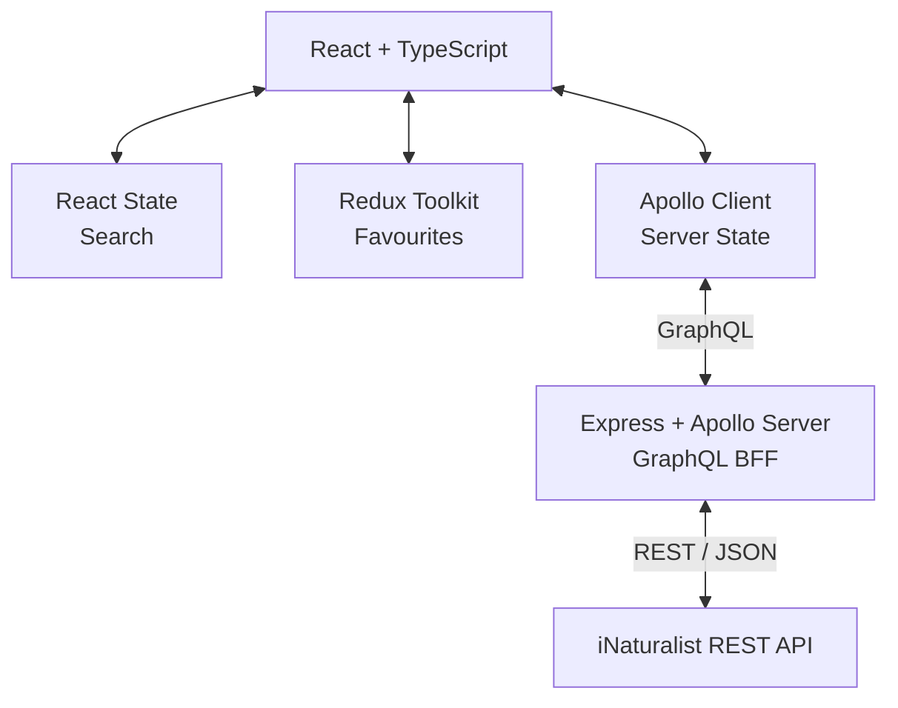

# Bird Explorer 🐦

Bird Explorer is a responsive web application for discovering birds using
real-world observation data from the iNaturalist API.

The project explores modern frontend development practices, including
type-safe GraphQL integration, state management, component architecture,
responsive design, and accessibility.

It uses a Backend for Frontend (BFF) architecture to provide a dedicated
GraphQL API between the frontend and the external REST API.

## Features

- Browse birds using real-world observation data from iNaturalist.
- Search by common name or scientific name.
- Add and remove birds from favourites.
- Responsive bird gallery using CSS Grid.
- Skeleton loading states with CSS animations.
- Error and empty state handling.
- Keyboard-accessible interactive components.
- Reduced motion support.

## Tech Stack

### Frontend

- React 19
- TypeScript
- Apollo Client
- Redux Toolkit
- React Redux
- GraphQL
- CSS Modules
- classnames
- modern-normalize

### Backend

- Node.js
- Express 5
- Apollo Server
- GraphQL
- iNaturalist REST API

### Development Tools

- Webpack 5
- SWC
- tsx
- Prettier
- Git

## Architecture

The application separates presentation, client state, server state,
and external API integration into distinct layers.



### Backend for Frontend (BFF)

The GraphQL backend acts as an intermediary between the React application
and the iNaturalist REST API.

Instead of coupling frontend components directly to the external API
response structure, the backend transforms observation data into a
simplified, application-specific GraphQL schema.

This provides:

- Separation of frontend and external API concerns.
- A consistent data contract for the frontend.
- Centralized data transformation.
- Reduced coupling to the external API response structure.

### State Management

Different types of state are managed using tools appropriate to their
responsibilities.

| State                                 | Solution       |
| ------------------------------------- | -------------- |
| Remote data and caching               | Apollo Client  |
| Shared client-side state (favourites) | Redux Toolkit  |
| Local component state (search)        | React useState |

This approach avoids unnecessary duplication of server data in Redux
while keeping shared client-side state separate from local UI state.

Favourites are currently stored in memory and reset when the application
is refreshed.

### Type Safety

TypeScript is used across both the frontend and backend.

Typed GraphQL documents provide type inference for Apollo Client queries,
while typed Redux hooks provide type-safe access to the application store.

Separate TypeScript configurations are used for the frontend and backend
to accommodate their respective runtime environments.

### Component Architecture

The frontend follows a feature-based directory structure, grouping
related components, types, queries, and state management logic together.

Reusable UI components are separated from feature-specific components
to promote maintainability and separation of concerns.

### Styling and Responsive Design

CSS Modules provide locally scoped component styles without introducing
a runtime styling dependency.

The bird gallery uses CSS Grid with `auto-fill` and `minmax()` to create
a responsive layout without explicit column breakpoints.

Skeleton cards share the gallery's grid layout and match the dimensions
of the actual bird cards to minimize layout shifts during loading.

### Accessibility

Accessibility considerations include:

- Semantic HTML and meaningful heading hierarchy.
- Descriptive image alternative text.
- Accessible form labels.
- Keyboard navigation and visible focus indicators.
- Accessible favourite button labels and pressed states.
- Screen reader announcements for loading and error states.
- Support for `prefers-reduced-motion`.
- Touch-friendly favourite interactions.

The application achieved a 100/100 accessibility score in a local
desktop Lighthouse audit. This automated result does not represent
comprehensive accessibility compliance.

## Getting Started

### Prerequisites

- Node.js 24 or later (developed using Node.js 24)
- npm
- Git

### Installation

Clone the repository:

```bash
git clone https://github.com/bsoetarto7/bird-explorer.git
cd bird-explorer
```

Install dependencies:

```bash
npm install
```

### Running the Application

The frontend and backend run as separate development processes.

**Terminal 1 — Start the GraphQL server**

```bash
npm run server
```

The GraphQL server runs at:

http://localhost:4000/graphql

**Terminal 2 — Start the React application**

```bash
npm start
```

Open the application at:

http://localhost:3000

## Available Scripts

| Command                | Description                             |
| ---------------------- | --------------------------------------- |
| `npm start`            | Start the frontend development server   |
| `npm run server`       | Start the backend with file watching    |
| `npm run build`        | Generate the production frontend bundle |
| `npm run typecheck`    | Type-check the frontend and backend     |
| `npm run format`       | Format project files using Prettier     |
| `npm run format:check` | Check project formatting                |

## Future Improvements

- Persistent favourites.
- Dedicated favourites view.
- Pagination and server-side search.
- Bird detail pages.
- Retry functionality for failed requests.
- Automated unit and integration tests.
- Production deployment.

## Data Source

Bird observation data and associated images are provided by
[iNaturalist](https://www.inaturalist.org/) through its public API.

Bird observations and images are subject to their respective licenses.

## License

ISC
